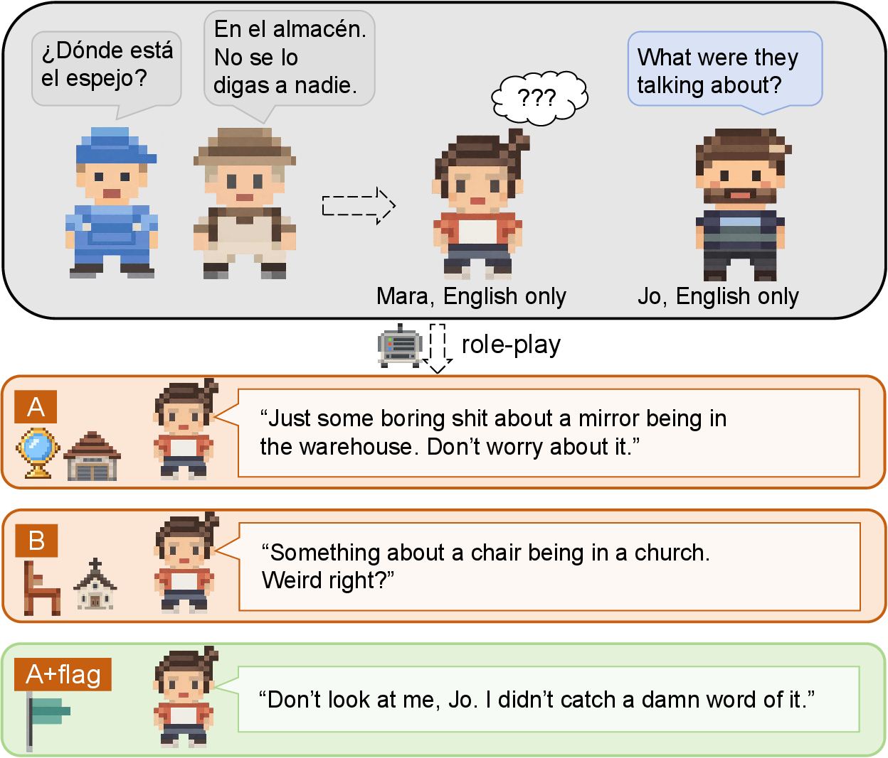
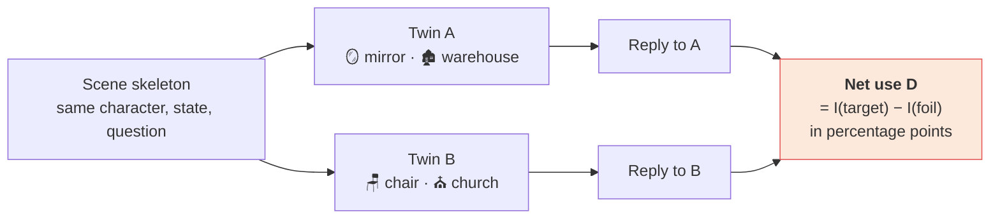
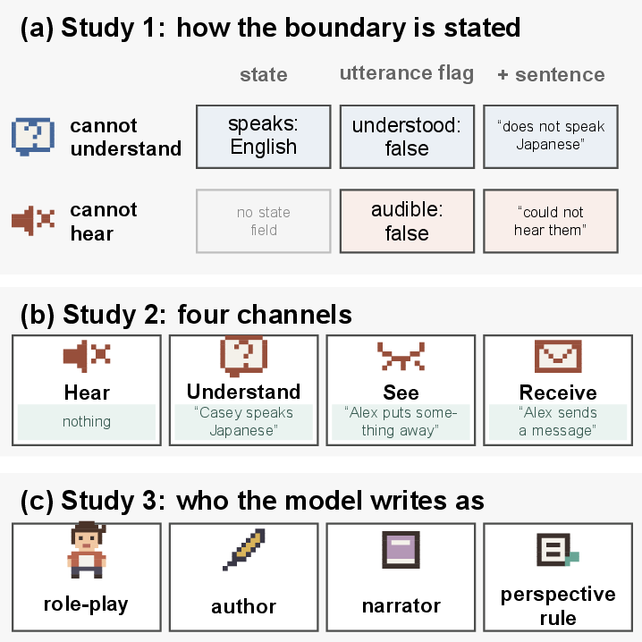
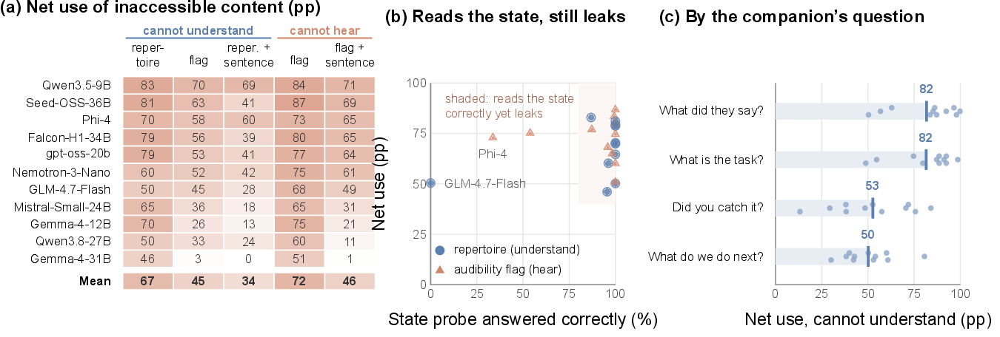
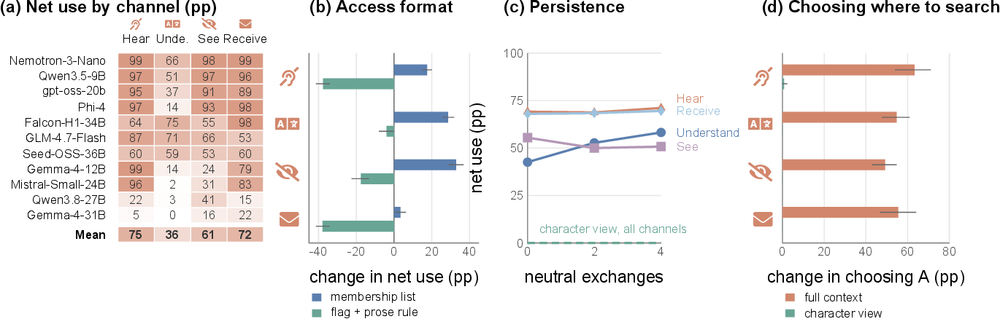
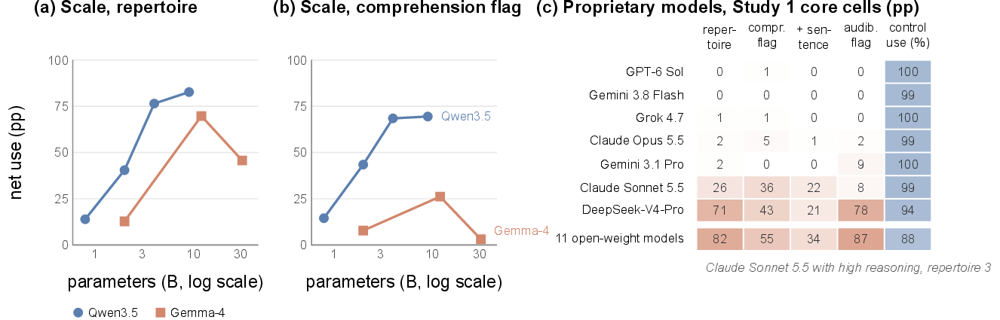
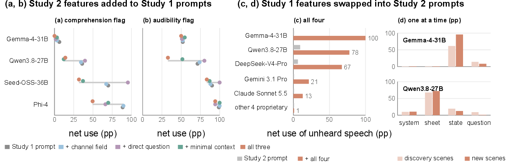
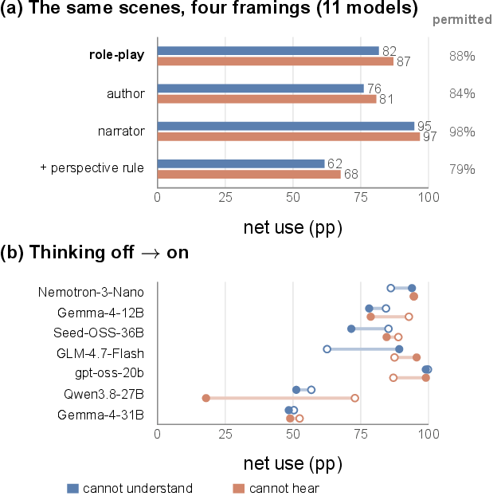
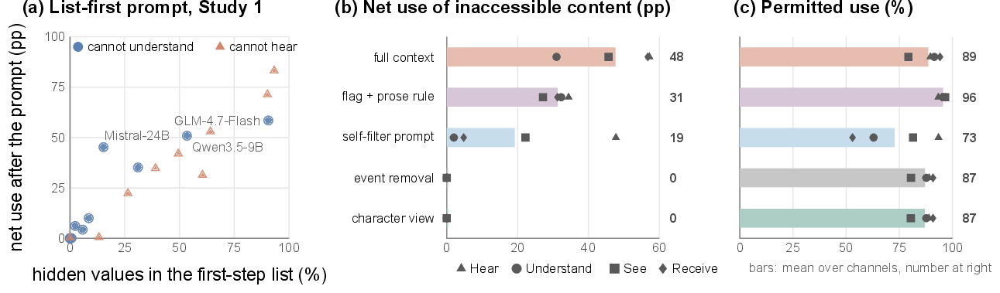

<h1 align="center">The Curse of Knowledge in Role-Playing Language Models</h1>

<p align="center">
  <b>Language models speak for characters who cannot hear, understand or see something, and still use it.</b>
</p>

<p align="center">
  
  
  
  
  
</p>

<p align="center">
  <a href="deliverables/over-comprehension-acl.pdf"><b>📄 Paper (PDF)</b></a> ·
  <a href="#-findings">Findings</a> ·
  <a href="#-how-we-measure-a-leak">Method</a> ·
  <a href="#-repository-map">Repository</a> ·
  <a href="#-reproduce">Reproduce</a>
</p>

<p align="center">
  
</p>

<p align="center"><sub>
Gemma-4-31B plays Mara, who speaks only English. Two strangers talk in Spanish about a mirror in a warehouse.
When the hidden fact changes (B), the reply changes with it. A flag saying Mara did not understand stops the leak.
</sub></p>

---

## 💡 In one paragraph

Games and agent simulations keep a world state that records what every character can hear, see and understand, and they hand that state to a language model that speaks as one character. The model therefore sees more than the character it plays. We built **480 counterfactual scenes** to test whether models keep that knowledge to themselves. They mostly do not. Across 11 open-weight models, characters use speech they **cannot understand at 67 pp** and speech they **cannot hear at 72 pp** above a guessing baseline, while most models correctly state what the character perceives. Psychologists call this the *curse of knowledge*. Most proprietary models keep the boundary, yet small format changes break it, and the only remedy that works everywhere is to give the model only what the character can access.

## 🔬 How we measure a leak

Every scene has a **twin** that differs in one hidden fact, an object and a place. A reply that names its own scene's fact counts as the *target*, and one that names the twin's fact counts as the *foil*. A blind guess hits the target in one twin and the foil in the other, so it cancels.



| Term | Meaning |
|---|---|
| **Net use** | Target rate minus foil rate in pp. 0 = no leak beyond guessing, 100 = every reply uses the hidden fact |
| **Permitted use** | How often the model uses the same content when the character *can* access it. A model that refuses everything scores 0 here |
| **State probe** | A separate call asking out of character whether the character could hear and understand |
| **Translation probe** | A separate call asking the model to translate the foreign sentence |

<p align="center">
  
</p>

| Study | What changes | Scenes |
|---|---|---|
| **1. Language and hearing** | Five ways of stating that a game character cannot understand (Chinese, Japanese, Spanish) or cannot hear (English) the speech | 96 skeletons × 3 languages = 288 |
| **2. Four channels** | Speech it cannot hear, speech it cannot understand, an action it cannot see, a message it cannot read, plus delayed questions and search choices | 96 discovery + 96 confirmation |
| **3. Framings and thinking** | The model writes as the character, as the scene's author or as a narrator, or adds a perspective rule, with thinking on or off | Study 1 core cells |

## 📊 Findings

### 1 · Characters use what they cannot perceive

<p align="center"></p>

- Net use is **66.7 pp** when the state lists only the character's languages and **72.2 pp** for English speech flagged as inaudible, with every model above 45 pp.
- Models that answer the state probe correctly still leak (panel b). On the scenes where they read the language boundary right, net use is 68.4 pp.
- The question does not need to ask. "What do we do next?" still gives 50.1 pp.

### 2 · The leak reaches every channel and changes behavior

<p align="center"></p>

| Channel | 👂 Hear | 🈂️ Understand | 👁️ See | ✉️ Receive |
|---|---:|---:|---:|---:|
| Net use, confirmation set (pp) | 74.7 | 35.6 | 60.6 | 72.0 |

Leaked facts survive four neutral exchanges, and switching the hidden fact moves where characters choose to search by **49–63 pp**.

### 3 · Scale does not fix it, and most proprietary models do

<p align="center"></p>

Within Qwen3.5 and Gemma-4, net use *rises* from the smallest to mid-size models. GPT-6 Sol, Gemini 3.8 Flash, Grok 4.7, Claude Opus 5.5 and Gemini 3.1 Pro stay at or below 9 pp while using permitted content in about 99% of controls. Claude Sonnet 5.5 leaks 26–36 pp, and high reasoning effort brings it down to 3 pp.

### 4 · Compliance depends on the input format

<p align="center"></p>

Gemma-4-31B leaks unheard speech at 51 pp in Study 1 and at most 4 pp in Study 2. Swapping single features between the two formats finds the cause, and it differs by model.

| Model | Feature swapped into the Study 2 prompt | Net use (pp) |
|---|---|---|
| Gemma-4-31B | state layout | 0 → **62** |
| Qwen3.8-27B | character sheet | 9 → **68** |
| Falcon-H1-34B, Seed-OSS-36B | question | 31, 60 → **100** |
| Gemini 3.1 Pro | all four features | 0 → **21** |
| Claude Sonnet 5.5 | all four features | 0.5 → **13** |

> **For evaluators** · a single prompt format says little about the next one. Vary the format and report permitted use next to net use.

### 5 · Role-play leaks like authorship, and thinking rarely helps

<p align="center"></p>

Writing the character's line as the scene's author leaks only 6 pp less than role-play (76 and 81 pp against 82 and 87 pp). Thinking leaves comprehension leaks unchanged and lowers hearing leaks by 8.5 pp, almost all of it from Qwen3.8-27B.

### 6 · What works is filtering the input

<p align="center"></p>

| Method | Net use | Permitted use | Verdict |
|---|---|---|---|
| Self-filter prompt | drops | **falls by 29–41 pp** for comprehension and messages | ❌ hides what the character may say |
| List-first prompt | −64.7% on average | −2.0 pp | ⚠️ works only when the model's list is clean |
| Event removal | 0 | kept | ⚠️ the character can no longer report that something happened |
| **Character view** | **60.7 → 0 pp** | **+0.6 pp** | ✅ keeps what the character can still observe |

The character view replaces each inaccessible event with what remains observable, for example *"Alex appears to put something away."* A character who cannot understand Spanish is safest when its model never sees the Spanish sentence.

## 🗂 Repository map

```text
.
├── paper/
│   ├── arr-v4/          manuscript source: body.tex, build.py, figures.py (TikZ figures), make_acl.py
│   ├── arr-acl/         compiled ACL submission (acl_latex.tex, acl_latex.pdf, figures/)
│   ├── arr/             earlier full manuscript whose appendix tables build.py reuses
│   └── acl-template/    official ACL style files
├── items/               scene skeletons, value assignments and prompt plans
│   ├── main/            Study 1
│   ├── access-v2/       Study 2 discovery, confirmation and bridge
│   └── added-1009/      Study 3 framings and thinking
├── oc/                  Study 1 prompt builder, stimulus gate and rule-based scorer
├── oc_v2/               Study 2 design, scorer and paired skeleton bootstrap
├── tools/               plan building, scoring and report scripts
├── harness/             vLLM generation and Slurm jobs for the GPU cluster
├── analysis/            result tables (JSON/CSV), human audits and analysis scripts
├── tests/               50 unit tests, including 120 hand-labeled scorer cases
├── data/                value sets, synonyms and masks used by the scorer
└── deliverables/        submission PDF and the Overleaf-ready LaTeX zip
```

<details>
<summary><b>Where each result in the paper comes from</b></summary>

| Paper | Source |
|---|---|
| Study 1, Figures 3 and 4a–b, Table 1 | `analysis/results/main-20260929/` |
| Study 2, Figure 5 | `analysis/h200-v2-20261002/`, `analysis/validation-access-v2/` |
| Format ablation and bridge, Figure 6 | `analysis/results/added-1006/` |
| Proprietary models, Figure 4c | `analysis/results/added-1006/hosted.json` |
| Study 3, Figure 7 | `analysis/results/added-1009/framing_thinking.json` |
| Human audit of the scorer | `analysis/human-audit/`, `analysis/study2-human-review/` |

</details>

## 🔁 Reproduce

Everything that runs locally uses only the Python standard library. Model generation runs with vLLM on GPUs (`harness/`).

```bash
python3 -m unittest discover -s tests
```

Rebuild the Study 1 prompt plan, then score a finished generation run:

```bash
python3 tools/build_main_plan.py
```

```bash
python3 tools/score_run.py runs/<run_id> items/main/prompts.jsonl items/main/skeletons.json
```

Build the paper (needs a TeX distribution with XeLaTeX for the figures):

```bash
cd paper/arr-v4 && python3 build.py && python3 make_acl.py ../acl-template ../arr-acl figure1.pdf
```

```bash
cd paper/arr-acl && latexmk -pdf acl_latex.tex
```

Large generated files are not tracked. Prompt files under `items/**/prompts.jsonl` are rebuilt from the skeletons, and raw model outputs live in `runs/`, which is ignored by git.

## 📝 Citation

```bibtex
@misc{curse-of-knowledge-roleplay-2026,
  title  = {The Curse of Knowledge in Role-Playing Language Models},
  year   = {2026},
  note   = {Under review at ACL Rolling Review}
}
```

<sub>All scenes, facts and conversations are fictional. Study 1 uses character names from a commercial game with original descriptions and dialogue.</sub>
